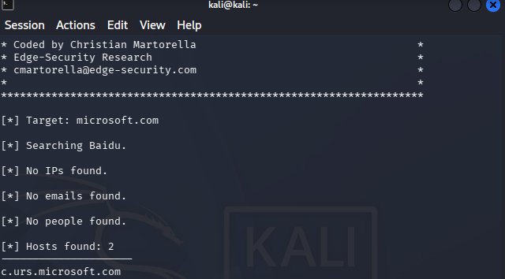
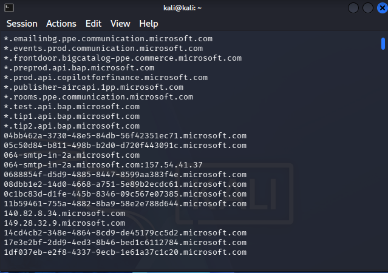
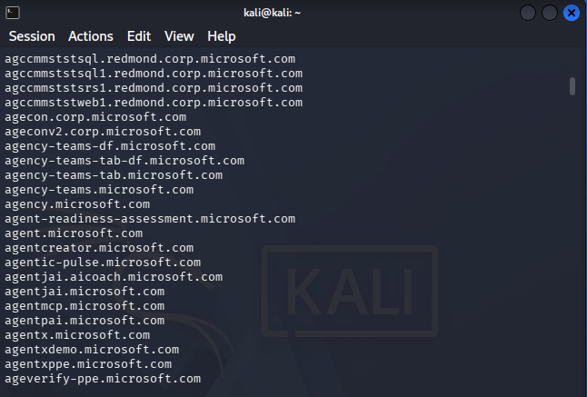
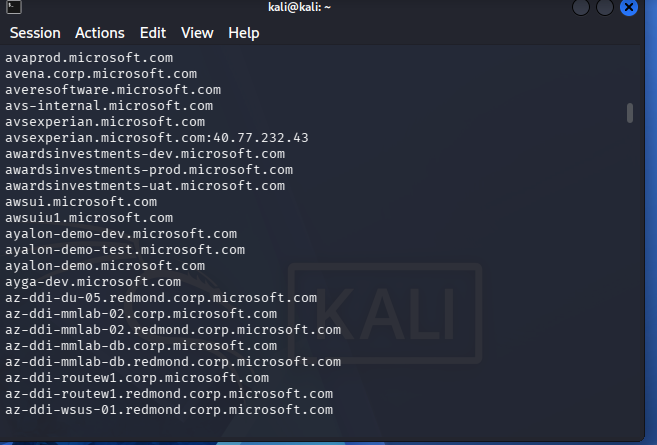
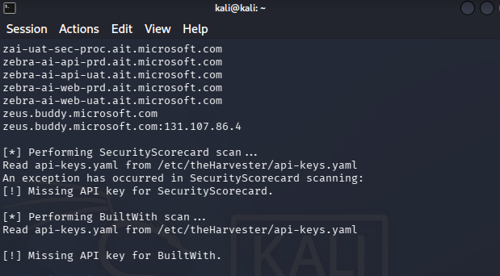

# 🛡️ NETWORKWALKS-MALEKAROUA-B084-WK2-THEHARVESTER-OSINT

Building practical passive OSINT reconnaissance, subdomain enumeration, and attack surface mapping capabilities using `theHarvester`

---

## 📌 Project Overview
This project documents hands-on practical exercises completed during Week 2 of the NetworkWalks cybersecurity training program (Batch B084). The focus of this module is Passive Open-Source Intelligence (OSINT) and External Attack Surface Enumeration using **`theHarvester` (v4.10.1)** on **Kali Linux**. By querying public search engines and multi-source intelligence feeds, this lab demonstrates how to harvest exposed subdomains, host endpoints, IP addresses, and corporate metadata without interacting directly with target network infrastructure.

---

## 🎯 Objectives
The main goals of these practical labs are:
- Master CLI-based passive OSINT reconnaissance workflows using `theHarvester` on Kali Linux.
- Compare data yield and metadata variability between single-source regional search engines (`baidu`) and multi-source aggregators (`all`).
- Map external attack surfaces by uncovering subdomains, internal environment naming conventions (`prod`, `preprod`, `uat`, `dev`), and IP associations.
- Understand commercial API key limitations (`/etc/theHarvester/api-keys.yaml`) while maintaining operational continuity using free public intelligence feeds.
- Apply an adversarial/Purple Team mindset to analyze harvested intelligence from both an attacker's (reconnaissance) and a SOC analyst's (asset discovery & perimeter hardening) perspective.

---

## 🛡️ Scope & Authorization
> **⚠️ Disclaimer:** All reconnaissance activities were conducted strictly for educational purposes as part of the official NetworkWalks cybersecurity curriculum. All data collection relied exclusively on passive, publicly accessible search engine indices and DNS records. No unauthorized access, active intrusion, or exploitation was performed against any target system.

---

## ⚙️ Environment & Tooling Summary

| Component | Specification / Setting |
| :--- | :--- |
| **Primary Environment** | Kali Linux (Rolling) / Pre-installed CLI Tooling |
| **Core Tool & Version** | `theHarvester` (v4.10.1) |
| **Reconnaissance Technique** | Passive OSINT Enumeration & Attack Surface Mapping |
| **Data Sources Queried** | `baidu`, `all` (Multi-Source Aggregator) |
| **Primary Target** | `microsoft.com` |
| **Configuration File** | `/etc/theHarvester/api-keys.yaml` |

---

## 📂 Project Structure & Modules

### Task 1: Single-Source Harvesting via Baidu (`1.png`)
- Executed a targeted passive search against `microsoft.com` using the regional search engine `baidu` with a result limit of 1,000:
  ```bash
  theHarvester -d microsoft.com -l 1000 -b baidu
  ```
- Established a baseline showing that single search engines yield specific, narrow slices of public data (returning 2 active host endpoints, including `c.urs.microsoft.com`, with zero IPs or emails).

### Task 2: Multi-Source Aggregation & API Feeds (`2.png`, `3.png`, `4.png`, `5.png`)
- Scaled enumeration across all integrated public data sources simultaneously against `microsoft.com` with a result limit of 50:
  ```bash
  theHarvester -d microsoft.com -l 50 -b all
  ```
- Uncovered an extensive inventory of subdomains, IP addresses (`157.54.41.37`, `40.77.232.43`, `131.107.86.4`), and internal naming structures (`redmond.corp`, `prod`, `preprod`, `uat`, `dev`).
- Observed and analyzed `[!] Missing API key` notices for commercial feeds (`SecurityScorecard`, `BuiltWith`) while verifying that `theHarvester` gracefully skips unauthenticated feeds to aggregate free public intelligence.

---

## 📊 Lab Documentation & Findings

### Reconnaissance Execution Summary

| Target Domain | Source Flag (`-b`) | Result Limit (`-l`) | Key Discovered Assets | Operational & API Observations |
| :--- | :--- | :--- | :--- | :--- |
| `microsoft.com` | `baidu` | `1000` | 2 Hosts (`c.urs.microsoft.com`) | Narrow baseline; 0 IPs/emails returned by regional index |
| `microsoft.com` | `all` | `50` | Extensive Subdomains, Internal Naming (`corp`, `uat`, `dev`), Mapped IPs | Triggered `Missing API key` warnings for `SecurityScorecard` & `BuiltWith` |

---

### Security & Operational Impact
1. **Attacker Perspective (Reconnaissance & Targeting):** Discovering subdomains with keywords like `dev`, `uat`, `preprod`, or `test` helps threat actors identify legacy or unpatched staging servers that may lack production-grade hardening, while exposed email patterns enable targeted spear-phishing.
2. **SOC Analyst Perspective (Asset Visibility & Defense):** Running passive OSINT against an organization's own domains uncovers "Shadow IT," forgotten public endpoints, and exposed API gateways (`api.*`) or documentation portals (`docs.*`), allowing defenders to verify WAF rules and authentication before attackers exploit them.

---

## 🖼️ Evidences Collected

### 1. Task 1: Single-Source Harvesting (`baidu`)


### 2. Task 2: Multi-Source Aggregation & Subdomain Discovery (`all`)




### 3. Task 2: API Key Limitations (`SecurityScorecard` & `BuiltWith`)


---

## 💡 What I Learned

1. **Source Variability & Multi-Engine Strategy:**  
   No single OSINT data source holds complete visibility. Regional search engines (`baidu`) and multi-source aggregators (`all`) each index distinct slices of public infrastructure, requiring analysts to combine multiple sources for comprehensive coverage.

2. **Navigating Commercial API Limits & Tool Quirks:**  
   Encountering missing API key warnings (`SecurityScorecard`, `BuiltWith`) is standard in real-world OSINT. Understanding how `theHarvester` isolates unauthenticated feeds ensures uninterrupted intelligence collection from free public sources.

3. **Subdomain Naming Conventions as Risk Indicators:**  
   Analyzing hostnames for environment prefixes (`prod`, `preprod`, `uat`, `dev`, `corp`) provides immediate insight into an organization's internal architecture and highlights potential legacy or staging assets that require priority security auditing.

4. **The Dual-Use (Purple Team) Reconnaissance Workflow:**  
   Mastered how passive OSINT bridges offensive and defensive operations:

   ```text
   Passive OSINT Query  --->  Subdomain & Host Discovery  --->  Attack Surface Analysis  --->  SOC Perimeter Hardening
   ```

---

## 🔗 Resources & References
- **NetworkWalks Cybersecurity Curriculum (Batch B084)**
- **theHarvester Official GitHub Repository:** https://github.com/laramies/theHarvester

---

## 👤 Author
**Malek Aroua**  
Computer Networks Graduate | Cybersecurity Specialist
